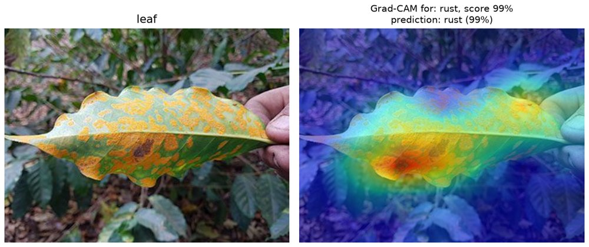
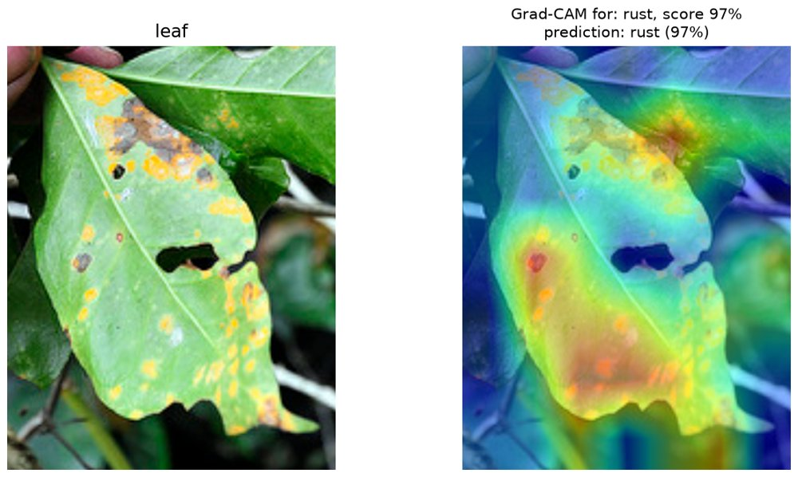
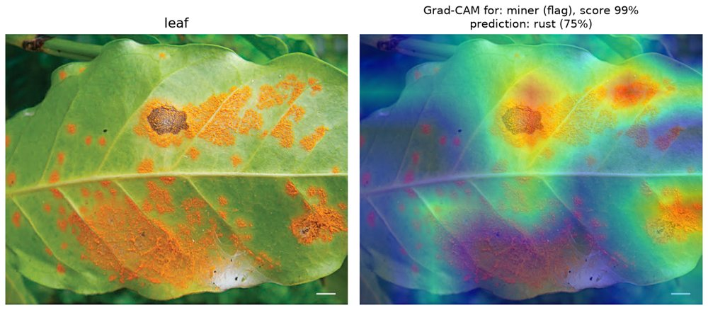

# Coffee leaf stress classifier

Classifies the predominant stress on an Arabica coffee leaf photo as **healthy, leaf miner, rust, phoma or cercospora**, using a fine-tuned MobileNetV3-Large. It also gives a weaker, secondary signal for other stressors present on the same leaf, and can draw Grad-CAM heatmaps to show where the model is looking.

Trained on the [BRACOL dataset](https://data.mendeley.com/datasets/yy2k5y8mxg) (Brazilian Arabica Coffee Leaf images). Everything lives in one script, `leaf_classifier.py`, with `train`, `predict` and `evaluate` commands.

## Results

| Evaluation | Main-stress accuracy | Macro-F1 |
|---|---|---|
| 5-fold cross-validation (1,401 leaves) | ~0.90 | ~0.88 |
| 10% holdout (135 labeled leaves, seed 42) | 0.919 | 0.904 |

Cross-validation is the more reliable number; the holdout set is small. Cercospora is the weakest class: it has the lowest flag F1 below, and the holdout run got 11 of 14 cercospora leaves right.

The per-stressor presence flags (pooled over cross-validation, threshold 0.5):

| Stressor | F1 |
|---|---|
| miner | 0.80 |
| rust | 0.92 |
| phoma | 0.95 |
| cercospora | 0.66 |

## How it works

One MobileNetV3-Large backbone (ImageNet-pretrained) feeds a shared fully connected layer, which feeds two heads:

- **Main head** (softmax over 5 classes): which stress predominates. This is the primary output.
- **Flags head** (4 independent sigmoids): is each stressor present at all. Used only as a "possible additional stress" hint.

Loss = flags BCE + 0.4 x main cross-entropy, with inverse-frequency class weights. Training is 3 epochs with the backbone frozen (lr 1e-3), then 15 epochs fine-tuning everything (lr 1e-4), using AdamW and a cosine schedule. The final epoch is kept; there is no checkpoint selection.

Leaves coded `5` ("multiple": similar-severity stresses, no predominant one) have no main label. They are excluded from the main-head loss but still count for the flags head.

## Setup

```bash
python -m venv .venv
.venv\Scripts\activate          # Windows; use `source .venv/bin/activate` on Linux/macOS
pip install -r requirements.txt
```

Download BRACOL from [Mendeley Data](https://data.mendeley.com/datasets/yy2k5y8mxg) (check the dataset page for its license) and arrange it as:

```
data/leaf/
  dataset.csv          # columns: id, predominant_stress, miner, rust, phoma, cercospora, severity
  images/<id>.jpg
```

Some CSV rows have no image; those are dropped automatically (1,401 of 1,747 rows have one).

## Usage

```bash
# Train on all labeled leaves -> outputs/model.pt, outputs/meta.json
python leaf_classifier.py train

# Keep 10% aside for a sanity check -> also writes <out>/holdout_ids.csv
python leaf_classifier.py train --holdout 0.1 --out outputs_holdout

# Predict on a file or a folder
python leaf_classifier.py predict path/to/leaf.jpg
python leaf_classifier.py predict path/to/folder --out-csv predictions.csv

# Grad-CAM heatmaps (for the predicted stress, or for one flag)
python leaf_classifier.py predict leaf.jpg --heatmap-dir heatmaps
python leaf_classifier.py predict leaf.jpg --heatmap-dir heatmaps --heatmap-for miner

# Score a model on labeled leaves; use the holdout ids for an unbiased number
python leaf_classifier.py evaluate --model-dir outputs_holdout --ids outputs_holdout/holdout_ids.csv
```

Run `python leaf_classifier.py <command> --help` for all options. The script runs on CPU only (`pick_device()` in the script).

### Reading the output

```
leaf.jpg: rust (85%)  | possible additional stress (low confidence): cercospora 42% (main head 6%)
leaf.jpg: rust (75%)  | heads disagree, check manually: miner 99% (main head 20%)
```

- The first number is the main head's probability for the predicted stress.
- The additional-stress list shows the flag probability for other stressors at or above 0.30, along with the main head's own probability for that stressor. These are raw scores, not calibrated probabilities, and not a yes/no.
- If a flag is at least as confident as the main prediction, the two heads disagree and the leaf should be checked manually.

## Examples

Grad-CAM heatmaps from `predict --heatmap-dir`. Left: the photo. Right: the regions that most increased the score of the named output. These are illustrations on photos from outside BRACOL, not evaluation results.



The heat falls on the lesions, which is what you want to see.



Coarser: most heat is on the lesion-heavy part of the leaf, but some spills onto the neighboring leaf (the map is only 7x7).

### A failure case



The main head predicts rust (75%), and the flags head scores miner at 99%. The miner heatmap lands on the rust lesions, not on leaf-miner tracks, and no tracks are visible, so this miner score looks like a false positive. This is why additional stresses are shown as hints and not as results, and why the script reports "heads disagree" when a flag is at least as confident as the main prediction.

## Limitations

- **Secondary stresses are unreliable.** In cross-validation, detecting a secondary stress had precision about 0.30 and recall about 0.36. Treat the flag line as a hint.
- **Cercospora** is the hardest class, with the lowest flag F1 and the lowest main-class recall.
- **Possible leakage.** The dataset has no plant ID, so near-duplicate photos of the same plant could be on both sides of a split and inflate scores.
- **Heatmaps are coarse.** Grad-CAM uses the 7x7 final feature map, so highlighted regions are approximate. The overlay is scaled by the target probability, so an unlikely class gives a dim map.
- Trained only on BRACOL's imaging conditions; performance on other cameras, backgrounds or regions is untested.

## Repository layout

```
leaf_classifier.py   training, prediction, evaluation, Grad-CAM
docs/                example heatmaps used in this README
requirements.txt
data/                dataset (not tracked)
outputs/             trained model and metadata (not tracked)
```
